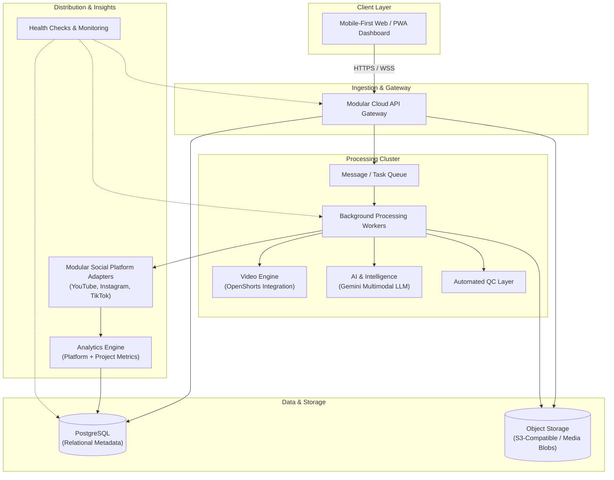

# Architecture Baseline

> # BASELINE FOR PHASE 01 VALIDATION
>
> **CRITICAL ARCHITECTURAL NOTICE:**  
> This document outlines the initial high-level conceptual baseline agreed upon for the platform.  
> **IT IS NOT THE FINAL ARCHITECTURE.**  
> Phase 01 (Architecture & Planning) will formally review, evaluate, validate, stress-test, or revise every component of this baseline before any implementation begins.

---

## 1. High-Level Architectural Baseline

---

## 2. Component Baseline Definitions

### 2.1 Frontend

- **Baseline:** Mobile-first responsive web / Progressive Web App (PWA) dashboard.
- **Role:** Facilitate media upload, review generated clips, adjust punchline tags, and trigger publication approvals from desktop or mobile devices.
- **Phase 01 Validation Goal:** Select optimal framework (e.g., Next.js vs. Vite+React), assess SSR vs. SPA tradeoffs, and establish design system requirements.

### 2.2 Backend

- **Baseline:** Modular cloud API gateway.
- **Role:** Handle authentication, route ingestion requests, manage relational state, and dispatch asynchronous tasks.
- **Phase 01 Validation Goal:** Validate framework (Fastify / Express / NestJS), establish API protocol (REST vs. GraphQL / tRPC), and define modularity patterns.

### 2.3 Database

- **Baseline:** PostgreSQL.
- **Role:** Structured relational data storage for user accounts, video metadata, processing job statuses, publication schedules, and analytics time-series.
- **Phase 01 Validation Goal:** Evaluate ORM/query builder options (Prisma, Drizzle, Kysely), connection pooling, and multi-tenant schema isolation.

### 2.4 Background Processing

- **Baseline:** Distributed queue + worker architecture.
- **Role:** Decouple time-consuming video rendering, audio extraction, and AI processing from synchronous HTTP request cycles.
- **Phase 01 Validation Goal:** Evaluate queue backends (Redis + BullMQ vs. Cloud-native queues such as SQS/Cloud Tasks), worker concurrency, and retry semantics.

### 2.5 Storage

- **Baseline:** S3-compatible cloud object storage.
- **Role:** Retain raw media uploads, intermediate video slices, audio stems, final 9:16 vertical renders, thumbnails, and caption files.
- **Phase 01 Validation Goal:** Define bucket lifecycle policies, presigned URL upload workflows, and edge CDN distribution.

### 2.6 Video Engine

- **Baseline:** OpenShorts integration.
- **Role:** Automated vertical reframing, intelligent scene cropping, visual centering, and caption burning.
- **Phase 01 Validation Goal:** Vet OpenShorts API/CLI integration, compute requirements (GPU vs. CPU), containerization, and fallback rendering pipelines (e.g., FFmpeg).

### 2.7 AI / Content Intelligence

- **Baseline:** Gemini (Google DeepMind multimodal models).
- **Role:** Long-form video comprehension, humor analysis, punchline discovery, transcription synchronization, and platform-tailored metadata generation.
- **Phase 01 Validation Goal:** Test Gemini 1.5/2.0 multimodal prompt engineering, latency, token economics, and structured JSON output compliance.

### 2.8 Quality Control (QC)

- **Baseline:** Automated automated QC layer.
- **Role:** Verify audio levels, speech-to-caption synchronization, aspect ratio conformity (1080x1920), duration constraints, and platform compliance prior to approval.
- **Phase 01 Validation Goal:** Determine validation rulesets, automated acceptance scoring, and rejection escalation workflows.

### 2.9 Publishing Adapters

- **Baseline:** Modular social-platform adapters.
- **Role:** Isolate platform-specific publishing APIs (YouTube Data API v3, Instagram Graph API, TikTok Content Posting API) behind a standardized publisher interface.
- **Phase 01 Validation Goal:** Audit platform token management, rate limit policies, and webhook callbacks.

### 2.10 Analytics

- **Baseline:** Platform analytics ingestion + internal project metrics.
- **Role:** Ingest video performance metrics (views, completion rate, likes, shares) and internal pipeline metrics (processing duration, cost per video).
- **Phase 01 Validation Goal:** Design ingestion schedules, aggregation schemas, and visualization endpoints.

### 2.11 Monitoring

- **Baseline:** Automated health checks + external monitoring.
- **Role:** Real-time visibility into queue depth, worker heartbeats, API latency, and failure alerting.
- **Phase 01 Validation Goal:** Select observability stack (OpenTelemetry, Prometheus/Grafana, or cloud-managed observability).
