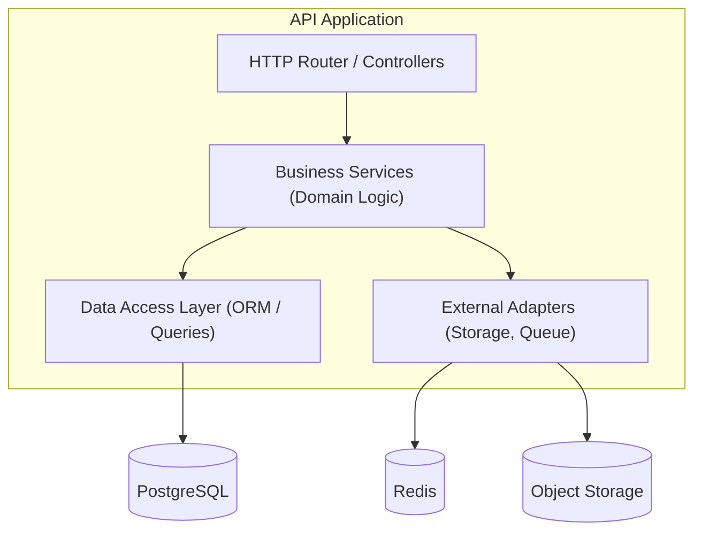
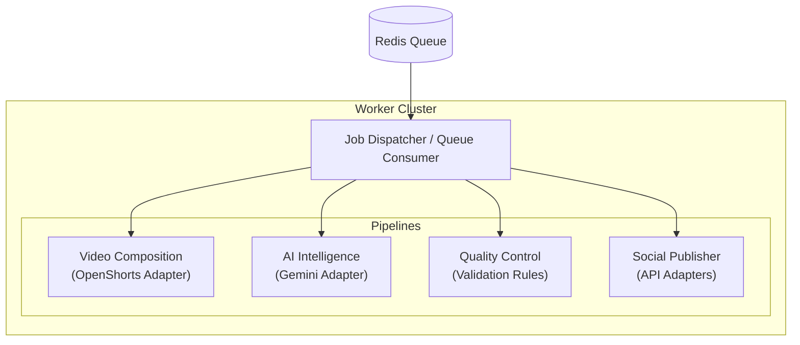
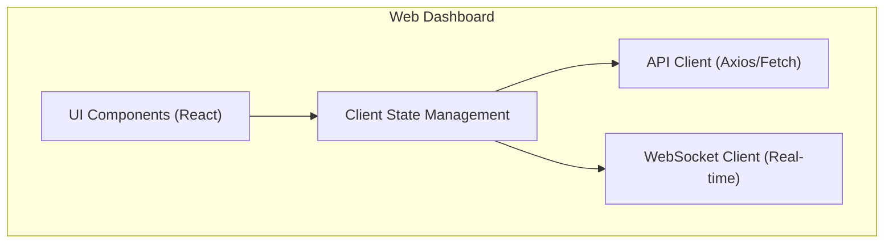

# Component Architecture

## 1. Overview

This document details the internal structure and responsibilities of the primary functional components within the Dadliesttjokes Content Factory platform.

## 2. API Component Architecture (Phase 02)

The API layer is structured into modular domains using a layered architecture pattern.

### 2.1 API Modules

- **Auth Module**: JWT issuing, verification, and role-based access control.
- **Media Module**: Presigned URL generation, upload lifecycle tracking.
- **Workflow Module**: Orchestrating the state machine of a video from 'Uploaded' to 'Published'.
- **Publisher Module**: Managing scheduled publication slots and profiles.

## 3. Worker Component Architecture (Phase 05/06)

The background worker cluster is built to consume targeted queues and execute specialized pipelines.

### 3.1 Worker Specialization

- **AI Workers**: Lightweight, network-bound. Responsible for communicating with Gemini to extract transcripts, jokes, and metadata.
- **Video Workers**: Heavy, compute-bound. Responsible for communicating with OpenShorts for rendering. May require GPU acceleration.
- **Publishing Workers**: Lightweight, network-bound. Responsible for reliable delivery to social APIs with exponential backoff for rate limits.

## 4. Web Client Architecture (Phase 04)

### 4.1 Client Responsibilities

- Provide a responsive layout for mobile and desktop review.
- Render video previews and temporal metadata (captions).
- Manage local state optimistically while synchronizing with the API.
