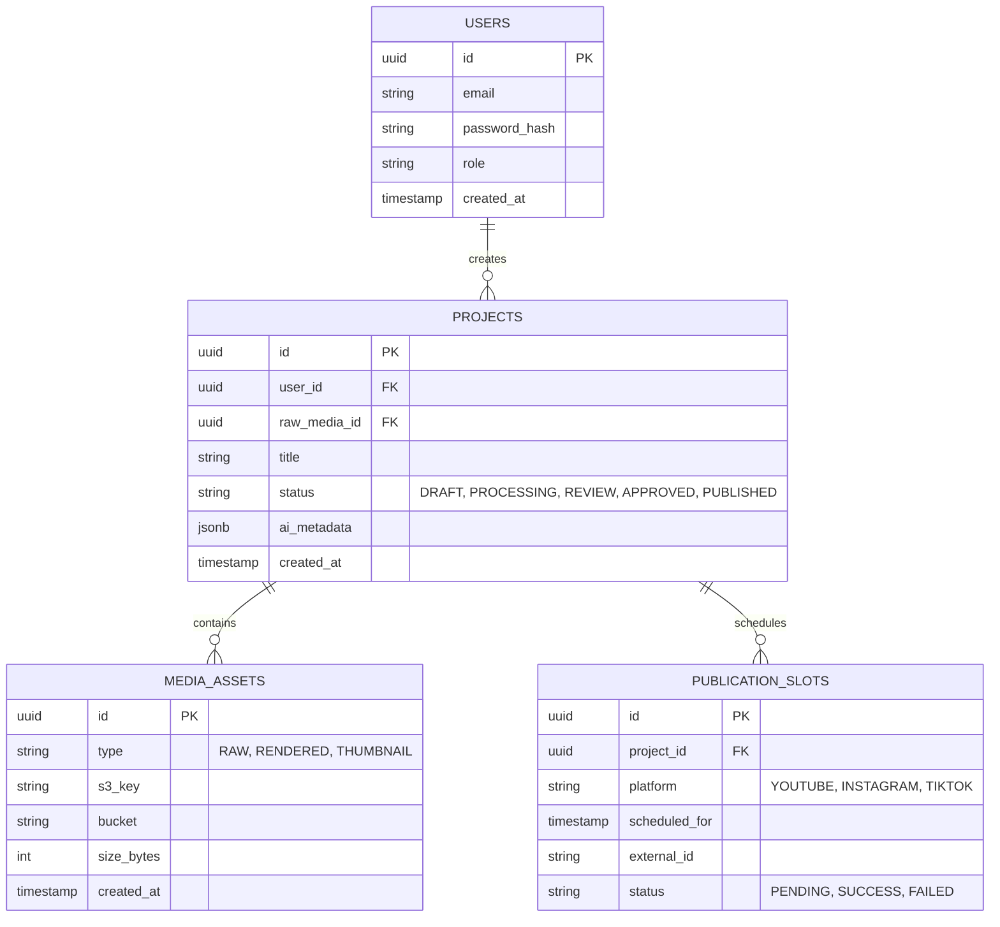

# Data Architecture

## 1. Overview

The Data Architecture defines how the platform stores, retrieves, and manages structured metadata (PostgreSQL) and unstructured media blobs (Object Storage).

## 2. Relational Schema (Target: Phase 03)

The PostgreSQL database will serve as the source of truth for application state.

## 3. Object Storage Lifecycle (Target: Phase 03/05)

Media is stored in Cloudflare R2.

### 3.1 Bucket Structure

- `dadliesttjokes-raw-inbox`: Temporary storage for unverified raw uploads.
- `dadliesttjokes-media-archive`: Long-term storage for verified raw assets and processed stems.
- `dadliesttjokes-renders-outbox`: Optimized short-form videos ready for distribution.

### 3.2 Access Pattern

1. Client requests upload capability from API.
2. API generates a short-lived S3 Presigned PUT URL.
3. Client uploads file directly to S3 (bypassing API bandwidth).
4. Client notifies API of completion, triggering background processing.

## 4. Caching & State (Redis)

- **Job Queues**: BullMQ/Redis used to store transient job state, progress, and retry counters.
- **Rate Limiting**: Redis used to enforce API rate limits and throttle publishing to respect social platform quotas.
