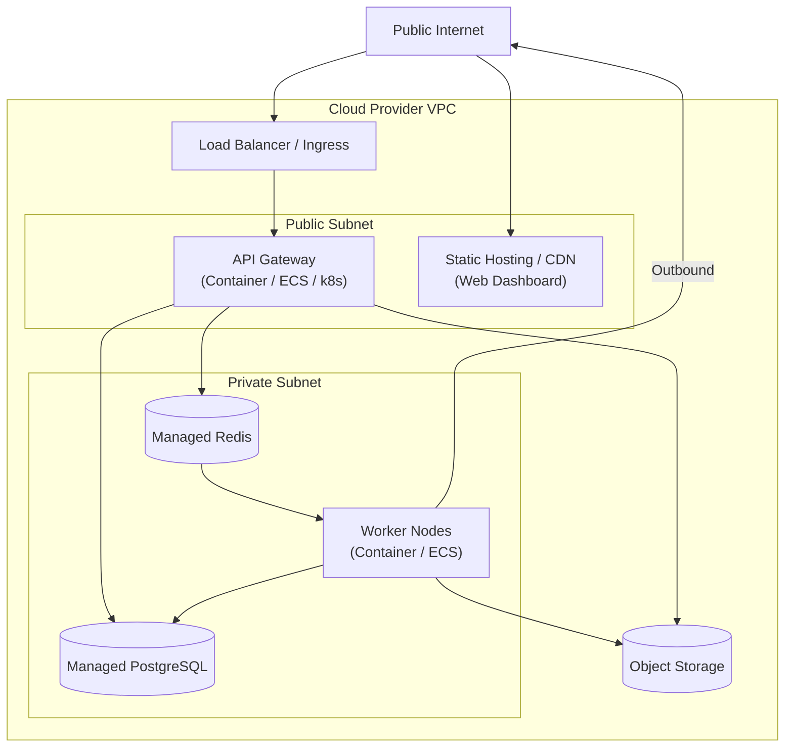

# Deployment Architecture

## 1. Overview

The Deployment Architecture defines how the platform transitions from source code to production execution across different environments.

## 2. Infrastructure Topology (Target: Phase 10)

## 3. Containerization

- **Docker**: The API and Worker services will be containerized.
- **Base Images**: Alpine or Distroless Node.js images to minimize attack surface.
- **GPU Requirements**: OpenShorts workers may require specialized instances with hardware acceleration (e.g., Nvidia T4/A10G) depending on rendering pipeline selection.

## 4. CI/CD Pipeline (Phase 02 / 10)

1. **Pull Request Check**: Lint, format, type-check, and run unit tests (via GitHub Actions).
2. **Merge to Main**: Trigger integration tests and build Docker images.
3. **Staging Deployment**: Deploy to a mirrored staging environment for final QA.
4. **Production Deployment**: Rolling or Blue/Green deployment to production cluster.

## 5. Observability

- **Logs**: Structured JSON logging routed to a centralized aggregator (e.g., CloudWatch, Datadog).
- **Metrics**: API latency, Queue depth, and Worker utilization monitored to trigger autoscaling policies.
