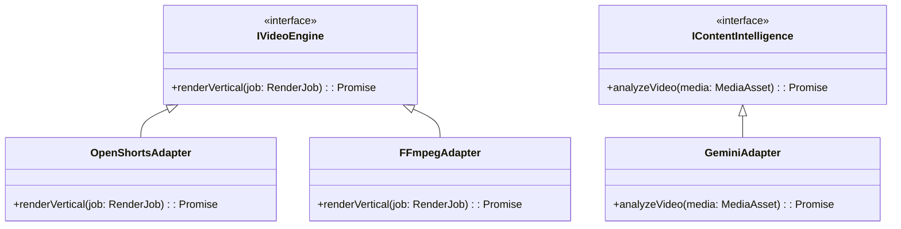

# Integration Architecture

## 1. Overview

The platform heavily relies on third-party services for AI intelligence, video composition, and distribution. This document details how these integrations are structured.

## 2. Adapter Pattern (Phase 02 / 05 / 06 / 08)

To prevent vendor lock-in and ensure testability, all external integrations are encapsulated behind strict interfaces (Ports and Adapters architecture).

## 3. Key Integrations

### 3.1 Gemini (Google DeepMind)

- **Purpose**: Multimodal video comprehension. Extracts transcriptions, identifies comedic beats, and generates captions/tags.
- **Integration**: REST/gRPC via official Google AI SDK.
- **Resilience**: Implements rate limiting and exponential backoff to handle quota restrictions.

### 3.2 OpenShorts

- **Purpose**: Headless video rendering engine.
- **Integration**: HTTP API or local CLI execution, depending on deployment topology.
- **Fallback**: Core FFmpeg wrappers will act as a rudimentary fallback if OpenShorts is unavailable.

### 3.3 Social Platforms (YouTube, Instagram, TikTok)

- **Purpose**: Final content distribution.
- **Integration**: OAuth 2.0 authorization flows. Tokens are securely encrypted and stored in PostgreSQL, refreshed automatically by the worker.
- **Compliance**: Adapters enforce platform-specific constraints (e.g., maximum length, aspect ratio) prior to transmission.
