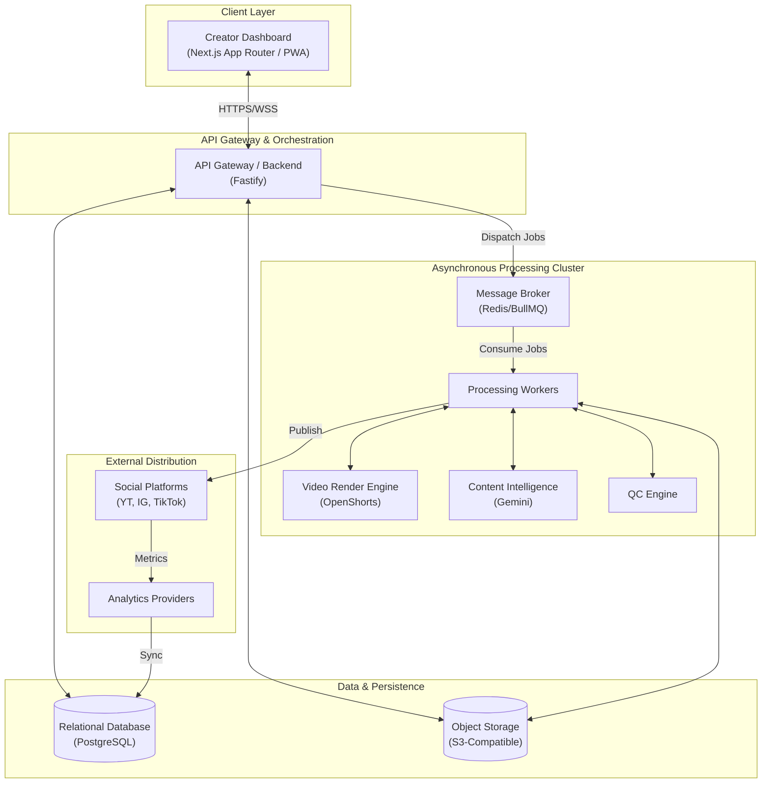

# System Architecture

## 1. Overview

The Dadliesttjokes Content Factory is a cloud-native, event-driven platform designed to automate the ingestion, processing, and multi-platform distribution of short-form video content. The system architecture is built to decouple heavy video processing and AI generation tasks from synchronous user interactions.

## 2. High-Level System Diagram

## 3. Core Subsystems

### 3.1 Client Layer (Phase 04)

Provides the interface for human creators to upload media, review AI-generated drafts, edit metadata, and approve content for publishing. Communicates with the API Gateway via HTTPS and WebSockets for real-time status updates.

### 3.2 API Gateway & Orchestration (Phase 02/03)

Serves as the central nervous system. Manages authentication, exposes CRUD endpoints for metadata, generates presigned URLs for direct-to-S3 media uploads, and orchestrates complex workflows by dispatching jobs to the queue.

### 3.3 Asynchronous Processing Cluster (Phase 05/06/07)

A highly scalable tier responsible for CPU/GPU-intensive tasks (video rendering via OpenShorts) and network-intensive tasks (AI processing via Gemini). It operates on an event-driven architecture, picking up jobs from the message queue.

### 3.4 Data & Persistence (Phase 03)

- **PostgreSQL**: Stores relational data (Users, Video Metadata, Job States, Social Profiles).
- **Object Storage**: Stores binary media assets (Raw video, intermediate slices, final renders, thumbnails).

### 3.5 External Distribution (Phase 08)

Modular adapters for interacting with third-party social media APIs. Handles OAuth flows, video uploads, and publishing schedules.

## 4. Architectural Principles

- **Asynchronous by Default**: Any task taking longer than 500ms (especially video rendering and AI calls) must be offloaded to the worker queue.
- **Stateless Services**: The API and Worker nodes must be stateless, storing all state in PostgreSQL, Redis, or S3, to allow horizontal scaling.
- **Interface Segregation**: External services (Gemini, OpenShorts, Social APIs) are accessed via standardized internal interfaces, allowing vendor swapping without changing core business logic.
